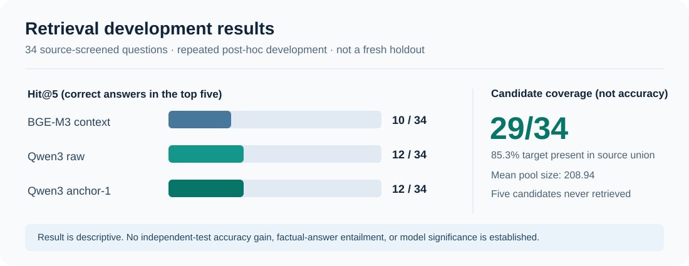

# ChronoHyper

**Native multiresolution abstraction of an evolving scientific knowledge hypergraph**

**Mohammad Amanlou** · Constructor Knowledge Labs research assessment · Python 3.11

ChronoHyper groups dated scientific entities into **nested four-level hierarchies** while retaining the identities, arities, provenance and endpoint multiplicities of native hyperedges. It tracks cluster membership through 2020, 2022 and 2024, with an exploratory 2025 snapshot. The contribution is an auditable *higher-order and temporal representation*, **not** a claim that its selected clustering or downstream retrieval is statistically superior.

> **Start with the [scientific report (PDF)](report.pdf)**, then [method and extended results](report.md). The PDF contains the **locked core assessment**; the Markdown report additionally records subsequent, explicitly post-hoc GPU development experiments.

## Main findings

| Study | Result | Interpretation |
|:--|:--|:--|
| Hypergraph representation | 5,798 entities · 1,429 native high-order events · 52 papers | Source-dated hierarchy, laminar memberships, event identity and multiplicity checks |
| Selected model | `native_temporal_20` | Semantics/structure/stability compromise; **not** the best on every metric |
| Constrained structural null | `p = 0.69` (99 shuffles) | No significant superiority over degree/arity-preserving null |
| Held-out source-group event cut ↓ | 0.6623 development → 0.7172 confirmation | **Worse**, not improved |
| 34 source-screened Type-A queries (predeclared models) | Flat **3/34**; four-root **2/34** Hit@5 | Routing used **59.3% fewer** online dot products, but lost one correct answer |
| Optional BGE-M3 development | Context **10/34** Hit@5 | Post-hoc on the **same 34** questions |
| Optional Qwen3-Reranker-0.6B development | Raw / dense-anchor-1 / dense-anchor-2: **12/34** Hit@5 | Modest descriptive change (+2/34); **not independent confirmation** |
| Gold-blind candidate union | **29/34** reference entities are present among ≤300 candidates (mean 208.94) | **Candidate recall, not Hit@5** |

[Machine-readable aggregate scores](research_outputs/gpu_retrieval_development_summary.json) (development only; private per-question Gold is excluded).

Matched 34-case post-hoc analysis: **5 wins / 3 losses / 26 ties** for each Qwen arm against BGE, unadjusted exploratory **p=0.7266** (not significant).

The Qwen3 **anchor-1** variant has the highest observed MRR@5 (**0.2181**); BGE context is **0.1887** and Qwen3 raw is **0.1814**. Anchoring is a development-only comparator, not a preregistered winner. The previous BGE cross-encoder worsened Hit@5 to **1/34**. Full-text scientific label faithfulness, truly new-corpus retrieval performance and generated Type-B answer correctness remain **unverified**.

*Figure: the 34 queries were source-screened before the first rank-only score, but reused for later model selection. The 29/34 bar denotes candidate **presence**, not correct top-five ranking.*

## Method at a glance

1. **Dated sources.** Parse the original 52-paper temporal hypergraph; admit events only when their papers and endpoints meet the cutoff.
2. **Native hierarchy.** Apply bounded, warm-started local optimization over semantic similarity, native hyperedge splitting and temporal inertia; enforce nested cluster budgets.
3. **Reproducible comparisons.** Record source-paper-group confirmation, 5-seed method families, clique projection, null shuffles, deletions, label evidence and negative outcomes.
4. **Exploratory retrieval.** Keep locked flat/routed baselines separate from later BGE-M3 three-view and Qwen3 reranking studies. Freeze ranking hashes **before** scoring local, private Gold.

The scalar objective in the report motivates a **heuristic**; it is not claimed to have been globally optimized. Co-occurrence does **not** prove a scientific relation, and paper titles alone do **not** establish full-paper factual entailment.

## Reproduce

~~~powershell
py -3.11 -m venv .venv
.\.venv\Scripts\python.exe -m pip install -r requirements.txt
.\.venv\Scripts\python.exe -m unittest discover -s tests -v
.\.venv\Scripts\python.exe verify_selected_outputs.py --out outputs_selected
.\.venv\Scripts\python.exe final_preflight.py --project .
~~~

The complete verified run paths, optional private GPU scripts and known caveats are in [reproduction instructions](docs/REPRODUCE.md) and [evaluation record](docs/EVALUATION.md). The original computational sweep is archived; there is no need to rerun it to view the scientific deliverables. Optional GPU dependencies are separate from the locked CPU environment.

## Repository map

| Path | Role |
|:--|:--|
| [report.pdf](report.pdf) / [report.md](report.md) | Locked PDF and its extended scientific discussion |
| [src/](src/) | Core native-hypergraph algorithm |
| [outputs_selected/](outputs_selected/) | Canonical hierarchies, collapsed native events and temporal tracking |
| [metrics.json](metrics.json) | Source-backed metrics |
| [research_lab/](research_lab/) | Optional experiments and their code/tests |
| [research_outputs/](research_outputs/) | Frozen experimental audit trail, including failed/null results |
| [docs/](docs/) | Evidence, reproduction and assessment limits |
| [AI_USAGE.md](AI_USAGE.md) | Material AI-assistance disclosure |

**Privacy and scientific integrity.** This is a **private** repository containing provider-supplied material. The original `inputs/data.zip` may include provider reference answers; do **not** publish the repo or distribute that archive without permission. Additional private reviewer ratings, blind mappings and newly held-out Gold remain in ignored local folders. GPU packages exclude the embedded provider Gold. Passing tests and repeated seeds on one corpus are not independent scientific validation.
