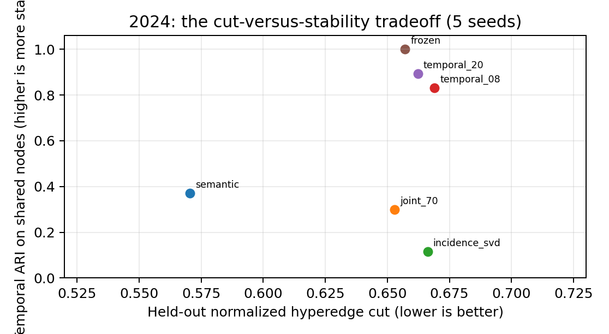

# Native Multi-Resolution Abstraction of an Evolving Scientific Knowledge Hypergraph

**Mohammad Amanlou · Constructor Knowledge Labs doctoral research assessment · updated 20 October 2026**

*Consolidated research report of the locked model. Source-grouped evaluation, four-level exports and exploratory Type-B paper retrieval have been reproduced; independent expert label faithfulness and factual-answer entailment remain unverified.*

## 1. Problem, formalization and evidence policy

The supplied temporal knowledge hypergraph (TKH) contains **5,798 entity nodes**, **1,429 original high-order hyperedges**, **52 source papers**, and **18 benchmark questions**. The required snapshots have 1,505 nodes/374 edges (2020), 2,164/526 (2022), and 4,164/983 (2024); an auxiliary 2025 snapshot has 4,995 nodes. A node is available no earlier than its first documented appearance; an event is available only if its endpoints and asserting article existed by the cutoff. A recorded concept year is not itself proof of prior observation.

For each snapshot, seek nested partitions \(P_{t,0}\prec P_{t,1}\prec P_{t,2}\prec P_{t,3}\) with **at most 12, 48 and 144 nontrivial clusters**, ending in singleton nodes. A candidate top-level partition \(c_t\) faces three competing desiderata: semantic affinity to a cluster centroid, native hyperedge connectivity (an event is split when its members span multiple clusters), and persistence of known node memberships across time. A motivating scalarization is

\[J(c_t) = \alpha \!\sum_{v\in V_t}\big(1-\cos(x_v,\mu_{c_t(v)})\big) + \beta\!\sum_{e\in E_t}\big(|\{c_t(v):v\in e\}|-1\big)+\gamma\!\sum_{v\in V_t\cap V_{t-1}}\mathbf{1}[c_t(v)\ne c_{t-1}(v)].\]

This is **a design-level motivation, not a claim of globally optimizing that precise objective**. The executable method uses bounded candidate-specific local move scores with distinct normalizations, partial centroid updates, a cluster size guard, and an explicit previous-membership bonus. It has no global-optimality guarantee. For the locked choice `native_temporal_20`, semantic/native-structure local weights are **0.70/0.30**, and temporal inertia is **0.20**. A word-hash + truncated-SVD semantic representation is fitted on 2020 node names and reused across later snapshots. New vocabulary may be poorly represented; using only names also limits scientific semantics.

**Guarantees by construction**: laminar membership, hard super-node budgets, exact accounting of all *processed training* hyperedges, and stable cross-year IDs under an overlap-based matching policy. **Not guaranteed**: expert-coherent concepts, truth of labels, best possible graph cut, optimal temporal dynamics, or downstream accuracy.

## 2. Native hyperedge coarsening and time evolution

Each source hyperedge remains **one identifiable event** with original event ID, relation type, paper provenance, original arity and endpoint multiplicity. For an event with all endpoints mapped to one super-node, the event becomes fully internal and is retained with multiplicity. A partially coarsened event retains distinct coarse endpoints and counts their original members. Events spanning three or more groups **stay high-order**, rather than being replaced by pairwise links. For every recorded event,

\[\sum_{g\in\operatorname{coarse}(e)}m_e(g)=|e|.\]

The same native collapse accounting is consulted during local refinement. Higher levels recursively split each parent, ensuring strict laminar refinement. Warm-starting and inertia stabilize recurring entities; overlap/Hungarian identity matching and a heuristic event logger annotate growth, birth, split, merge and death. These event labels describe an approximate bookkeeping model, not verified conceptual change points. In the selected-source-group export, 2020, 2022 and 2024 use respectively **12/48/141/1,505**, **12/48/144/2,164**, and **12/48/144/4,164** clusters across their four levels. The separate 2025 export is exploratory. The audited coarse events are those used to fit the model; held-out paper events were intentionally excluded from fitting, so those files are **not a collapse of all original events**.

## 3. Literature-driven alternatives and evaluation controls

The implementation compares **13 method configurations** under one 5-seed (11, 17, 29, 41, 53) development matrix: semantic-only, structure-dominant and blended native hyperedge variants, three temporal regularization strengths, incidence-matrix SVD initialization, deliberately frozen memberships, and two arity/source reweighting hypotheses. A separate 5-seed **unweighted clique-expansion** baseline is recorded, bringing the number of distinct compared configurations to 14. The latter inflates an arity-\(r\) event into \(r(r-1)/2\) pairwise edges; it is a diagnostic, **not** a weight-matched substitute for a hypergraph algorithm. None of these baseline names implies an exact implementation of a full published spectral eigensolver or of Mt-KaHyPar.

The 65 development model-seed jobs comprise **195 year fits**, plus five three-year projection jobs. All job outcomes, parameters, paper splits and per-run JSON results are retained, including negative results. The train/development/confirmation source-paper groups are fixed in protocol files; confirmation was run **only after a single model (`native_temporal_20`) was locked**. This is restricted *source-grouped confirmation*: representation fitting can still see a shared universe of entity names. The five seeds are repeated algorithmic initializations of the **same 52-paper corpus**, not 5 independent datasets.

Semantic coherence is approximated with **source-paper title n-grams**, rather than the node-name vectors used in the clustering objective; the two signals can still correlate. The unmodified baseline study additionally contains equal-size random cluster controls and native degree/arity-preserving incidence shuffles. The current selected configuration's **99-shuffle** structure null and **five** deletion perturbations retain identical prior-year conditioning as the reference. Small paper-group counts and dependence prevent strong generalization claims.

## 4. What worked, what failed, and independent checks

| 2024 method (5-seed dev means) | Held-out event cut ↓ | Title coherence ↑ | Temporal ARI ↑ |
|---|---:|---:|---:|
| Semantic KMeans | **0.5705** | 0.1147 | 0.3718 |
| Native joint, no inertia | 0.6529 | 0.1168 | 0.2995 |
| Native temporal 0.08 | 0.6690 | 0.1182 | 0.8310 |
| **Locked native temporal 0.20** | 0.6623 | 0.1229 | **0.8930** |
| Incidence SVD + refinement | 0.6662 | **0.1782** | 0.1165 |
| Frozen previous (control) | 0.6571 | 0.1105 | **1.0000** |
| Clique pairwise (separate 5 seeds) | 0.6219 | 0.1167 | 0.3137 |

**Negative result A — no general superiority.** The semantic baseline has the best *held-out hyperedge cut*, while incidence SVD has the highest title-coherence proxy. Our locked model is chosen for a time-sensitive interpretation/structural trade-off, **not** because it dominates. The frozen control attains ARI 1.0 by deliberately refusing to revise survivor memberships; its perfect ARI is scientifically uninformative on its own. Arity normalization and source-balancing did not convincingly outperform the temporal reference; the full registry preserves these runs.

**Negative result B — confirmation degradation.** The selected model's source-grouped held-out cut rose from **0.6623** in development to **0.7172** in confirmation (an absolute **+0.0549**, approximately **8.3%** worse relative to development; lower is better). Its title coherence and temporal ARI are unchanged because the same selected partitions underlie both stages; those are **not two independently repeated demonstrations**. On 2024 seed 17, 10%-edge-deletion reruns give mean partition ARI **0.9666**. In **99** degree/arity-preserving randomized event controls, the empirical lower-cut p-value is **0.69**: this does **not** establish superiority to the null.

**Negative result C — label quality.** Manually recorded, non-blind title ratings for 48 sampled cluster labels are **8 accurate, 28 vague, 12 wrong**. Only **8 gloss-overclaim decisions are definite**, and **40 are marked unclear**; 0/8 definite cases were called overclaims, with a Wilson 95% upper limit of approximately **0.324** for that small evaluable subset. This is **not 0/48**, **not independent blinded evaluation**, and cannot substantiate P6 as scientifically solved. Separately, automatic structural membership-claim audits flag 3/60 (2020), 2/60 (2022), and 0/60 (2024) unsupported bounded claims. A contrastive evidence-cited V2 labeler has now been implemented on the **same locked partitions** (60 candidate labels at levels 0–1 in each of 2020/22/24); its dated node-name occurrences and provenance were mechanically checked (1,146/1,510/2,599 respectively). Four/two/zero low-evidence labels abstained. **Twenty-four V1/V2 paired cases were rated diagnostically by ChatGPT, not a blinded human reviewer**: six V2 accuracy wins, two V1 wins and sixteen ties on a 0–2 title scale (mean change +0.167; descriptive two-sided sign-test p=0.289). Separately, subjective title/gloss preference favored V2 in 18 cases, V1 in three, and tied in three. Pairing used exact candidate-text matches, not the private A/B key. These are **non-independent, already-seen, sample-level AI opinions**, not a confirmed semantic-accuracy improvement, NLI validation or a reliable gloss-overclaim rate.

## 5. Extrinsic utility, limitations and four-week plan

The **already-inspected** 18-question benchmark is used *exploratorily*, not as an untouched test after design iteration. For 14 type-A list questions at the conservative 2025 cutoff, flat surface-match **Hit@5 = 1/14 (0.0714)**, hierarchical **Hit@5 = 2/14 (0.1429)**. Mean candidate node-count proxies were 2,682 vs 1,088; the hierarchical figure excludes centroid comparisons and neither result demonstrates lower end-to-end latency. Four Type-B explanation questions were additionally evaluated for **paper-source retrieval only**, using a frozen ranking generated before reading gold references. Among the gold papers that could be matched to 46 cutoff-eligible articles, macro source Recall@5 was **0.5208 for BOTH flat and hierarchical routing**; counting unavailable gold papers, both were **0.3125**. An exact-search control recovered identical top-5 rankings on 18/18 inspected queries but was slower in measured end-to-end time. This supplies **no retrieval improvement**, factual-answer accuracy or source-claim entailment claim. For 36 required Type-B claim rubrics, an exploratory AI audit traced 19 to directly inspected publisher/preprint abstracts or selected publisher-text sections, while 17 remain rubric-only; **0/36 were independently adjudicated against complete full-text evidence**. All 18 benchmark questions were previously inspected, so results are exploratory, not unseen evaluation.

**Threats to validity.** The entire assessment spans only 52 source articles; the input node names are partly transductive across paper splits; metric objectives and held-out measures do not perfectly coincide; source-title n-grams are a correlated second view, not expert-blind semantic grounding; proposed clusters' scientific labels remain mostly vague/wrong; the 99 constrained shuffles give no significant structural advantage; the few deletion perturbations yield descriptive rather than general confidence intervals. The confidence bounds of five seeds describe initialization variability on this corpus, not independent cross-corpus validity.

**Four-week validation plan:** (1) secure authorized qualified-source review of the 24 AI-screened label pairs and 36 Type-B claim passages; (2) compare a fair arity-weighted pairwise projection and published hypergraph baseline without retuning confirmation; (3) freeze on a second independently sourced corpus; (4) implement answer generation with passage attribution and real coarse-to-fine candidate-pruned retrieval, accounting for preprocessing, centroids and wall-clock. No independent human review or grounded generated answer was performed in the current assessment. Each new experiment gets a versioned registry entry without modifying this locked baseline or retroactively redefining confirmation.

**New source-scoped V2 title audit and AI coherence control (20 October 2026).** All 23/23 literal `N of M` member-name-count gloss claims in 24 frozen V2 examples were reproduced against full eligible cluster membership; one qualitative abstention remained unresolved. This is **0/23 count errors**, not a scientific overclaim rate: **all 24 full-paper semantic-entailment judgments remain unknown**. Two additional AI-only blind-sheet ratings favored V2 on title scores (7 wins, 1 loss, 16 ties and 9 wins, 3 losses, 12 ties), but neither provides independent scientific validation. Twenty-three more conservative V2 title changes have been proposed **post hoc** and are **not** deployed in the locked output or claimed to have improved held-out quality.

An exploratory 48-row AI name-sample coherence check compared 24 genuine 14-member level-one samples to 24 year/size-matched mixed samples. Mean rating was **3.67/5 vs 2.33/5**, with 19 genuine-higher, 2 control-higher and 3 ties (descriptive paired sign p=0.000221; exploratory bootstrap CI +0.79 to +1.88). The assistant giving the opinions had already seen part of the condition key in context, **so this is not a fully independent blind test**. It assesses only sampled names and **does not overturn** the degree/arity-preserving structural null result (p=0.69). See `research_outputs/coherence_ai` and `docs/EVALUATION.md`.

**Research position:** This is a reproducible native hyperedge-aware hierarchy with valuable negative controls, not a proven scientific ontology or downstream retrieval improvement. The V2 pilot and Type-B source audit are **exploratory, non-independent**; neither establishes independently faithful labelling or factual-answer correctness. Those findings must remain visible rather than hidden behind run counts.

**Selected literature** — Zhou, Huang & Schölkopf, *Learning with Hypergraphs: Clustering, Classification, and Embedding* (NeurIPS, 2006); Chakrabarti, Kumar & Tomkins, *Evolutionary Clustering* (KDD, 2006); Traag, Waltman & van Eck, *From Louvain to Leiden* (Scientific Reports, 2019); Schlag et al., *High-Quality Hypergraph Partitioning* (ACM JEA, 2022). These inform conceptual baselines; no verbatim algorithm reproduction is claimed.
